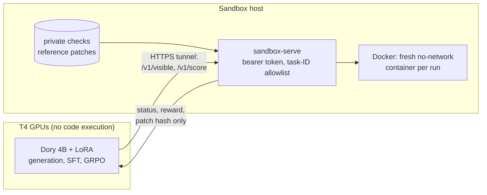

# Toolsmith

**Teach a 4B model to fix Python bugs with tools: prompting vs. SFT vs. GRPO, with
every patch checked in a sandbox.**

Toolsmith gives [NVIDIA Nemotron Labs Dory 1.0 4B](https://huggingface.co/nvidia/NVIDIA-Nemotron-Labs-Dory1.0-4B-BF16)
four tools (`read_file`, `edit_file`, `run_visible_tests`, `submit_patch`) and a
bounded budget, then measures what supervised fine-tuning (SFT) and reinforcement
learning (stateful GRPO) add to plain prompting. Submitted patches are scored by
private checks in fresh Docker containers that the model never sees. Training ran
on T4 GPUs; all generated code ran only on a separate sandbox host.

The trained SFT and GRPO LoRA adapters are on Hugging Face:
[harshit2312/dory-4b-toolsmith-lora](https://huggingface.co/harshit2312/dory-4b-toolsmith-lora)
(`subfolder="sft"` or `subfolder="grpo"`).

## Results

Same 340 frozen tasks for every model: seed 17, temperature 1.0, top_p 0.95, 256
new tokens per turn, 8 tool calls per episode.

| Split | Prompt-only | LoRA SFT | GRPO from prompt-only |
| --- | --- | --- | --- |
| dev | 82/100 | 100/100 | 98/100 |
| test_iid | 80/100 | 100/100 | 92/100 |
| test_compositional | 70/100 | 100/100 | 95/100 |
| challenge | 23/40 | 31/40 | **34/40** |
| **all** | **255/340 (75.0%)** | **331/340 (97.4%)** | **319/340 (93.8%)** |
| tokens per episode | 308 | 150 | 245 |

- **No wrong patches.** No model ever submitted a wrong patch. 82 of the base
  model's 85 failures were turns that ran out of the 256-token limit while it
  explained the fix.
- **SFT: +22.4 points** (95% CI +17.9 to +26.8; 77 tasks gained, 1 lost), mostly
  from concise tool use. It copies its demonstrations' limits too: after a failed
  test it re-submits unchanged code or re-runs the test until its budget ends.
- **GRPO from the prompt-only model: +18.8 points** (95% CI +14.1 to +23.5; 70
  gained, 6 lost), with no demonstrations and only 14 of its 150 training steps
  carrying any reward signal. It learned shorter turns, and it is the best model on
  the hardest split: challenge 34/40, and `challenge_split` 5/10 vs. SFT's 2/10
  (that challenge edge over SFT is not significant: +7.5 points, CI −2.5 to +17.5).
  Overall it trails SFT by 3.5 points (CI −5.9 to −1.2); 18 of its 21 failures are
  still truncated turns.
- **GRPO from SFT learned nothing.** The SFT policy is nearly deterministic: every
  group of 4 rollouts was identical and successful, so all 150 steps had zero
  advantage and the adapter did not change.

The recorded runs behind these numbers are in [results/](results/): `toolsmith
compare` recomputes every table and interval, and `toolsmith view` shows each
task's tool timeline and patch (see Quickstart).

## How it works



- **Episodes.** An episode is a strict tool-call loop. Malformed, truncated, or
  over-budget replies end it as recorded failures; they are never repaired.
- **Data split.** The GPU side receives only public task inputs and verified
  demonstrations. Private checks stay on the sandbox host.
- **SFT** trains only on the tokens the model generates at inference, verified
  token for token against the inference prompt.
- **GRPO** uses TRL's `rollout_func`. Each group is G independent episodes of one
  task, generated in lockstep, and tool results are masked from the loss.
  Sandbox failures yield no reward; TRL excludes those episodes from the advantage
  instead of scoring them as wrong.

## Quickstart (CPU only)

Install [uv](https://docs.astral.sh/uv/getting-started/installation/), then:

```sh
uv sync --locked
uv run pytest -m "not sandbox" -q
uv run toolsmith data generate --config configs/data.toml --output data/generated/repair-v1
uv run toolsmith compare --runs base=results/runs/base sft=results/runs/sft grpo=results/runs/grpo-base --output reports/frozen-340
uv run toolsmith view --runs base=results/runs/base sft=results/runs/sft grpo=results/runs/grpo-base --tasks data/generated/repair-v1 --output reports/viewer
```

`compare` recomputes the tables and bootstrap intervals from the recorded runs in
[results/](results/). `view` writes a static, read-only HTML site
(`reports/viewer/index.html`) with each task's public inputs, tool timeline,
submitted patch, and evaluator outcome for every run. The base package has no
third-party runtime dependencies; `.python-version` selects Python 3.12.

## Try the hybrid router

The included [pagination task](examples/pagination/task.json) contains a bug report,
a buggy source file, and a visible regression test. Loading it reads text only;
the embedded Python is never imported or executed.

```sh
uv run toolsmith route --task examples/pagination/task.json --policy configs/router.toml
```

The task fits the initial small-model limits, so the route is `small`. The JSON
also reports actual input features, resolved policy, and `mode: decision_only`.

To inspect what would happen **if** a small attempt failed its visible tests:

```sh
uv run toolsmith route --task examples/pagination/task.json --after-small visible_failed --allow-large
```

This selects `large`. The outcome flag is supplied by you for inspection; it is
not evidence that a model or test ran. Omitting `--allow-large` selects `stop`
with `blocked_by: large_disabled`, rather than silently using a paid route.
`--allow-large` permits a decision only; this command makes no API calls.

To inspect a large attempt that passed visible tests:

```sh
uv run toolsmith route --task examples/pagination/task.json --after-large visible_passed
```

This returns `accept_candidate`, **not verified repair success**. Only the
independent evaluator's private checks establish success. Hidden test results are
never inputs to the router or triggers for escalation.

### Policy

[configs/router.toml](configs/router.toml) holds the initial heuristic:

```toml
[router]
small_max_files = 3
small_max_input_bytes = 12000
```

Tasks exceeding either limit route directly to large, subject to explicit
permission. Otherwise they start small. Limits are inclusive. Input bytes include
the issue, paths, source, and visible tests; this is not a token count. Without
`--policy`, these same built-in limits apply. Invalid configuration fails rather
than silently using defaults.

These thresholds are **hand-set heuristics**, not a learned difficulty model. The
router is never trained or fitted; edit the TOML to change it.

Accepted attempt outcomes are `visible_passed`, `visible_failed`,
`budget_exhausted`, `infrastructure_error`, and `invalid_patch`. Supply only one
of `--after-small` or `--after-large`. Visible failure/budget exhaustion after small
can escalate; infrastructure/policy failures stop; a failed large attempt stops.
The inspector does not maintain episode history. Live escalation (a runner
deriving outcomes from sandbox execution, with spending caps) was dropped from
this project, so these outcomes are always supplied by you.

## Task format

Public manifests contain exactly `schema_version`, `task_id`, `issue`,
`source_files`, and `visible_tests`; see the example for the exact shape. Source
paths must be canonical relative Python paths under `src/`; visible tests live
under `tests/`. Invalid paths, duplicate JSON keys, invalid field types, and
private/unknown fields are rejected. File contents remain data, not trusted
executable code.

Only controlled synthetic projects are in the initial scope. Task validation is
not an execution sandbox. Do not execute generated project code on the host.

## Run the sandbox and evaluator

Start Docker Desktop (or a Linux Docker daemon), then explicitly build the image:

```sh
docker build -t toolsmith-sandbox:py312-v1 sandbox
uv run toolsmith sandbox-check
```

The base image is pinned by digest and test dependencies by version. Commands
never pull/build implicitly. Each execution resolves the image to an immutable ID
and records it. Missing Docker/image is an infrastructure error, never a reason
to run generated code on the host.

Containers use a non-root user, no network, read-only root/source/tests, dropped
capabilities, no-new-privileges, and a bounded temporary filesystem. Defaults:
10 wall seconds per container, 256 MiB memory, one CPU, 64 processes, and 64 KiB
combined captured output. Docker log storage is disabled for these executions.
`--timeout` and `--output-limit` override those two limits for the CLI.

Evaluate the included source repair:

```sh
uv run toolsmith evaluate-patch \
  --task examples/pagination/task.json \
  --patch tests/fixtures/repair/correct.patch \
  --checks tests/fixtures/repair/private.json \
  --output runs/reference-repair
```

The output directory must be new. It records `result.json`, `submitted.patch`,
and the public task manifest. These are **reference-fixture results**, not model
results. Exit 0 means evaluation/probe passed; exit 1 means a non-success outcome;
invalid CLI inputs/configuration exit 2.

Also try `broken.patch`, `hardcoded.patch`, or `forbidden.patch` from the same
fixture directory, with a distinct output directory for each. They respectively
leave the defect, overfit the visible example, and try to modify a test.

Private checks contain a task ID and cases with `id`, `module`, `function`, JSON
`args`/`kwargs`, and exactly one `expected` value or `raises` exception name. Each
case runs in a fresh container. Expected values stay on the host; the evaluator
compares returned values/types outside the tested process. These fixture files
are public in the repo; “private” means withheld from the agent and its workspace,
not secret from repository readers. Evaluation details must not be fed back to
the router.

**Security limit:** this is a controlled synthetic-code benchmark, not a public
service for arbitrary hostile uploads. Containers share their VM/kernel, and an
in-process Python reporter can be manipulated. Independent expected values and
fresh reconstruction reduce common cheating paths; they do not prove immunity
to sandbox escapes or adaptive reward hacking.

## Generate the repair dataset

```sh
uv run toolsmith data generate --config configs/data.toml --output data/generated/repair-v1
uv run toolsmith data validate --directory data/generated/repair-v1
```

Generation is deterministic and CPU-only; generated programs are text and are
never executed on the host. [configs/data.toml](configs/data.toml) sets seed 17
and 500 train, 100 dev, 100 IID test, 100 compositional test, and 40 challenge
tasks. Each task is a small `src/solution.py` with one bug, a visible pytest that
fails on the original, 2–4 private input/output checks, and a reference patch.

| Split | Template families |
| --- | --- |
| train | `filter_floor`, `affine_map`, `delimiter_values` |
| dev | `filter_ceiling`, `affine_sum`, `delimiter_first` |
| test_iid | `interval_filter`, `affine_even`, `delimiter_last` |
| test_compositional | `filter_then_affine`, `parse_then_affine` |
| challenge | `challenge_window`, `challenge_clamp`, `challenge_chunk`, `challenge_split` |

Families are fixed per split before sampling, and each split draws constants
from a disjoint range. "IID" means familiar bug classes in unseen templates, not
an identical distribution. Compositional tasks combine primitives seen separately
in train. Every (buggy, fixed) program pair is unique across all splits after
normalizing names, comments, and docstrings. The 40 challenge tasks are explicit
edge-case specifications with written notes, checked for unambiguous bug reports,
visible tests that exhibit the bug, and private checks that probe the stated edges.

Public files (`<split>.jsonl`) contain only the task manifest. Private checks,
reference patches, and metadata live in `private/<split>.jsonl`. Validation
regenerates the dataset from its recorded config and requires byte-identical
files, so relabelled families, poisoned expectations, or edited sources are
rejected even when an attacker recomputes hashes.

With the sandbox image built, execute every task in Docker and build the
train/dev reference demonstrations:

```sh
uv run toolsmith data validate --directory data/generated/repair-v1 --execute --output runs/repair-v1-verification
uv run toolsmith data demonstrations --directory data/generated/repair-v1 --output data/generated/repair-v1/demos
```

`--execute` requires each original to fail its visible test on an assertion (not
a crash or collection error) and each reference patch to pass every private
check. Demonstrations run the same five public tool calls (read, run tests, edit,
run tests, submit) through a bounded episode, replay them in a fresh episode, and
score the submitted patch with the independent evaluator. Only verified
transcripts are kept; failures are listed in the manifest. `--workers` (1–8,
default 4) sets parallel containers.

Episodes allow 8 tool calls and 16,384 bytes of serialized context. That is a
byte budget; model turns are also capped at 256 new tokens and 4,096 context
tokens.

## Reproduce the GPU experiments

The notebook scripts in `kaggle/` run on T4 GPUs and are pushed with the Kaggle CLI
(API token in `~/.kaggle/`; GPU and internet access enabled for the account).
Generated code still runs only in Docker on the sandbox host, behind an
authenticated service that the notebooks reach through a cloudflared quick tunnel.
Private checks never leave the sandbox host; the service answers `/v1/visible` and
`/v1/score` with summary fields only.

```sh
# Per run: fresh token, service, tunnel (keep the sandbox host awake and online).
uv run toolsmith sandbox-serve --directory data/generated/repair-v1 --score-log runs/sandbox-scores.jsonl --rotate-token
cloudflared tunnel --no-autoupdate --url http://127.0.0.1:8765
uv run python kaggle/push_token.py --kaggle-user <user>

# Public dataset (tasks, demonstrations, wheel; no private checks).
uv build --wheel
uv run python kaggle/make_public_dataset.py --directory data/generated/repair-v1 --wheel dist/toolsmith_rl-0.1.0-py3-none-any.whl --output build/kaggle-public --dataset-id <user>/toolsmith-repair-public

# Gate, baseline, SFT, SFT evaluation, GRPO (two starting points, one per T4).
uv run python kaggle/push.py gate --kaggle-user <user> --kernel toolsmith-dory-gate --run-name gate
uv run python kaggle/push.py eval --kaggle-user <user> --kernel toolsmith-dory-baseline --run-name dory-base-full --url <tunnel-url> --splits dev test_iid test_compositional challenge
uv run python kaggle/push.py sft --kaggle-user <user> --kernel toolsmith-dory-sft --run-name dory-sft-seed17
uv run python kaggle/push.py eval --kaggle-user <user> --kernel toolsmith-dory-sft-eval --run-name dory-sft-full --url <tunnel-url> --splits dev test_iid test_compositional challenge --adapter-kernel toolsmith-dory-sft
uv run python kaggle/push.py grpo --kaggle-user <user> --kernel toolsmith-dory-grpo --run-name dory-grpo-seed17 --url <tunnel-url> --start base sft --adapter-kernel toolsmith-dory-sft --max-steps 150 --learning-rate 2e-5 --hours 8
kaggle kernels output <user>/toolsmith-dory-grpo -p runs/kaggle-grpo
uv run python kaggle/push_adapter.py --kaggle-user <user> --adapter-dir runs/kaggle-grpo/grpo-base/adapter --slug toolsmith-grpo-base-adapter
for i in 0 1; do uv run python kaggle/push.py eval --kaggle-user <user> --kernel toolsmith-dory-grpo-base-eval-$i --run-name dory-grpo-base-shard$i --url <tunnel-url> --splits dev test_iid test_compositional challenge --adapter-dataset toolsmith-grpo-base-adapter --adapter-dir toolsmith-grpo-base-adapter --shard $i/2; done
uv run toolsmith merge-runs --shards runs/kaggle-grpo-base-eval-0/dory-grpo-base-shard0 runs/kaggle-grpo-base-eval-1/dory-grpo-base-shard1 --name grpo-base --output results/runs/grpo-base
```

Run `sandbox-serve` with `--workers 8` while two GRPO runs share the service; at most
two GPU notebooks run at once. The token reaches the notebooks through a private
dataset (`toolsmith-sandbox-token`), replaced each time the service starts with
`--rotate-token`. Each notebook writes its results to `/kaggle/working`
(`kaggle kernels output <user>/<kernel>`).

## Development

```sh
uv run pytest -m "not sandbox" -q
uv run ruff check .
uv run ruff format --check .
uv build
```

Run the container integration tests only after building the image:

```sh
TOOLSMITH_RUN_SANDBOX_TESTS=1 uv run pytest -m sandbox -q
```

Without that opt-in, container tests skip; with it, missing Docker/image fails
rather than silently skipping. GitHub Actions runs CPU checks on macOS/Linux and
real Docker checks on Linux. No GPU, model download, or paid provider is required
for either.

## Limitations

- **Narrow tasks.** Synthetic, templated, single-function tasks with one seed.
  Intervals cover task sampling, not training seeds.
- **Binding turn cap.** The 256-token turn limit decides most base failures; a
  different protocol would move the baseline.
- **Scripted demonstrations.** SFT imitates their five-call script, including the
  missing recovery after a failed test.
- **Sandbox scope.** The sandbox suits controlled synthetic code, not hostile
  uploads: containers share a kernel, and an in-process test reporter can be
  manipulated.
- **No live escalation.** The hybrid router is implemented and tested as a
  decision engine only; no larger model ran.

## License

Code, generated data, and original fixtures: [MIT](LICENSE). The base model,
[NVIDIA Nemotron Labs Dory 1.0 4B](https://huggingface.co/nvidia/NVIDIA-Nemotron-Labs-Dory1.0-4B-BF16)
(revision `f6c832e6`), is NVIDIA's under [OpenMDW-1.1](licenses/OpenMDW-1.1.txt).
Adapters derived from it must ship with that agreement and this notice of origin:
"NVIDIA-Nemotron-Labs-Dory1.0-4B-BF16, by NVIDIA, under OpenMDW-1.1." The
[published adapters](https://huggingface.co/harshit2312/dory-4b-toolsmith-lora) do.
Model weights, checkpoints, credentials, and generated datasets are not committed
here; regenerate the dataset with `toolsmith data generate`.
