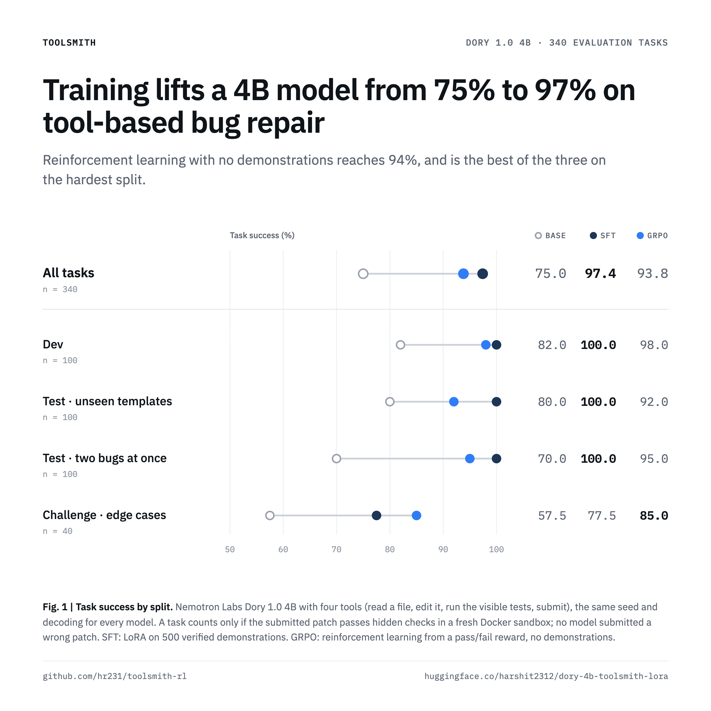
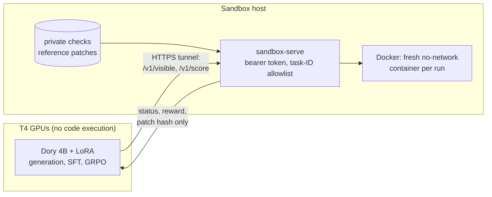

# Toolsmith

**Fine-tuning a 4B model to fix Python bugs with tools: prompting vs. SFT vs. GRPO,
with every patch checked in a sandbox.**

[NVIDIA Nemotron Labs Dory 1.0 4B](https://huggingface.co/nvidia/NVIDIA-Nemotron-Labs-Dory1.0-4B-BF16)
gets four tools (`read_file`, `edit_file`, `run_visible_tests`, `submit_patch`) and
a fixed budget. A fix counts only if it passes private checks in a fresh Docker
container the model never sees. The trained adapters are on Hugging Face:
[harshit2312/dory-4b-toolsmith-lora](https://huggingface.co/harshit2312/dory-4b-toolsmith-lora)
(`subfolder="sft"` or `subfolder="grpo"`).



## Results

340 frozen tasks; every model gets the same seed (17), decoding (temperature 1.0,
top_p 0.95), 256 new tokens per turn, and 8 tool calls.

- **SFT: 97.4%** vs. 75.0% prompted, +22.4 points (95% CI +17.9 to +26.8), with
  half the tokens per task (150 vs. 308).
- **GRPO from the prompt-only model: 93.8%** with no demonstrations, +18.8 points
  (CI +14.1 to +23.5), and the best challenge score (34/40 vs. SFT's 31/40; not
  significant).
- **GRPO from SFT learned nothing.** SFT is nearly deterministic, so every group
  of 4 rollouts got the same reward and the adapter never changed.
- **No model submitted a wrong patch.** Failures were unfinished episodes, mostly
  turns cut off at the 256-token limit.

[results/](results/) holds the recorded runs: `toolsmith compare` recomputes every
number, and `toolsmith view` renders each task's tool calls and patch.

## How it works



- Episodes are strict tool-call loops: malformed, truncated, or over-budget replies
  end the episode as recorded failures and are never repaired.
- The GPU side sees only public task inputs; private checks stay on the sandbox
  host.
- SFT trains only on tokens the model generates at inference. GRPO (TRL
  `rollout_func`) masks tool results from the loss and leaves sandbox failures out
  of the advantage.

## Quickstart (CPU only)

```sh
uv sync --locked
uv run toolsmith data generate --config configs/data.toml --output data/generated/repair-v1
uv run toolsmith compare --runs base=results/runs/base sft=results/runs/sft grpo=results/runs/grpo-base --output reports/frozen-340
uv run toolsmith view --runs base=results/runs/base sft=results/runs/sft grpo=results/runs/grpo-base --tasks data/generated/repair-v1 --output reports/viewer
```

Then open `reports/viewer/index.html`. Needs [uv](https://docs.astral.sh/uv/) and
Python 3.12; no GPU or Docker.

For the sandbox, evaluator, dataset, GPU runs, tests, and router, see
[REPRODUCE.md](REPRODUCE.md).

## Limitations

- Synthetic, single-function tasks and one training seed.
- The 256-token turn cap decides most base-model failures; a different protocol
  would move the baseline.
- SFT copies its demonstrations' five-call script, including no recovery after a
  failed test.
- The sandbox is built for controlled synthetic code, not hostile uploads.

## License

Code, generated data, and fixtures: [MIT](LICENSE). The base model is NVIDIA's,
under [OpenMDW-1.1](licenses/OpenMDW-1.1.txt); the
[published adapters](https://huggingface.co/harshit2312/dory-4b-toolsmith-lora) ship
with that agreement and the notice "NVIDIA-Nemotron-Labs-Dory1.0-4B-BF16, by NVIDIA,
under OpenMDW-1.1."
